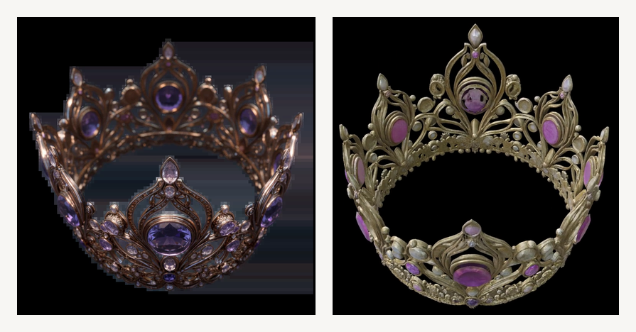
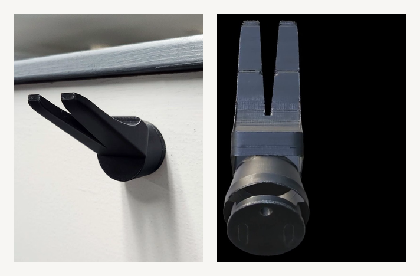
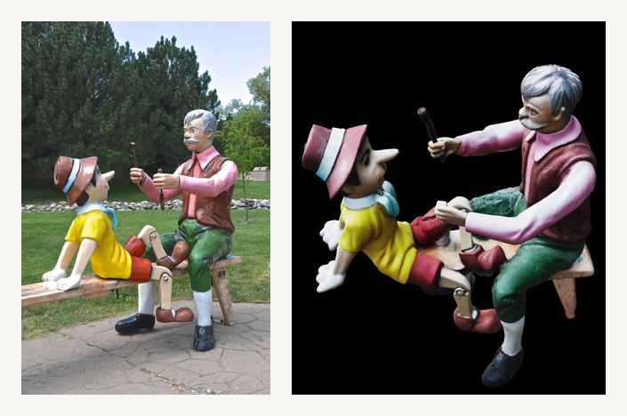

<div align="center">

# Geppetto

### A picture goes in. A 3D model comes out.



*Drop in a photo. Get back a textured GLB you can spin, and an STL you can print.*

</div>

---

We put together a few pieces to make this easy for you to reproduce and use for academic and hobbyist
purposes in project **Geppetto**. The hard parts — the gated weights, the six CUDA extensions that
have to compile just so, the platform differences between a workstation GPU and a DGX Spark — are
already solved here. Clone it, pull the container for your hardware, and convert a picture in about
two minutes.

> *We love the idea of Geppetto wishing his wooden boy into real life, and we think it captures what
> TRELLIS and the projects around it have handed to us hobbyists: the ability to take something flat
> and imagined, and make it real enough to hold.*

**What you get:**

- A **REST API** with a job queue, so long generations do not block anything
- A **web UI** built into the container — open a page, pick a file, press a button
- A **CLI client** with no dependencies beyond the standard library
- An **agent skill** for Claude and Copilot, so "make this printable" works in a chat
- **Two containers**, one per hardware target, both built and smoke-tested on real GPUs

Built on **[Microsoft TRELLIS.2](https://github.com/microsoft/TRELLIS.2)** — a single 2D image to a
textured 3D asset with real PBR materials, plus a printable STL.

### Two release targets

| Target | Hardware | Status |
|---|---|---|
| `nvidia-cuda` | x86_64 + NVIDIA Ada (sm_89) — RTX 6000 Ada, 4090, L40S | **Verified** end to end |
| `dgx-spark` | aarch64 + GB10 Grace Blackwell (sm_121) — DGX Spark | **Verified** end to end |

Both come from one Dockerfile; everything that differs is a build arg, so the two cannot silently
drift apart. Each machine builds its own image — about 15 minutes, no published containers to pull.

**→ [HOWTO.md](HOWTO.md) is the step-by-step guide**: build, install, and use it from the browser,
the command line, the API, or an agent.

> **Status:** research / hobbyist deployment. Read [Licensing](#licensing--what-you-can-actually-do-with-this)
> before this touches anything commercial — the answer is genuinely not "it's MIT, go ahead".


---

> Also: if STL's generated don't work with your printing or other scenarios, try running them thru this free repair tool:
> https://www.formware.co/onlinestlrepair

---

## Table of contents

- [What TRELLIS.2 is](#what-trellis2-is)
- [How it works](#how-it-works)
- [Original research and links](#original-research-and-links)
- [Licensing](#licensing--what-you-can-actually-do-with-this)
- [Gated dependencies — read first](#gated-dependencies--read-this-before-you-build)
- [Requirements](#requirements)
- [Quick start](#quick-start)
- [The web UI](#the-web-ui)
- [Choosing an input image](#choosing-an-input-image)
- [Using the API](#using-the-api)
- [Batch conversion](#batch-conversion)
- [Parameter guide](#parameter-guide)
- [Performance](#performance)
- [Repository layout](#repository-layout)
- [How the image is built](#how-the-image-is-built)
- [Building and releasing](#building-and-releasing)
- [HOWTO — the practical guide](HOWTO.md)
- [Troubleshooting](#troubleshooting)
- [Scaling to more than one GPU](#scaling-to-more-than-one-gpu)
- [Related work and alternatives](#related-work-and-alternatives)
- [Citation](#citation)

---

## What TRELLIS.2 is

TRELLIS.2 is a **4-billion-parameter flow-matching Diffusion Transformer** from Microsoft Research that generates a complete 3D asset from **one image**. It is the successor to [TRELLIS](https://github.com/microsoft/TRELLIS) (CVPR 2025 Spotlight).

**What it does:**

| | |
|---|---|
| Input | A single image. RGBA cut-outs work directly; otherwise background removal runs automatically. |
| Output | A **GLB** mesh with full PBR materials — base colour, roughness, metallic, opacity — plus an optional PBR turntable MP4. |
| Resolutions | 512³, 1024³, 1536³ voxels. |
| Geometry | Arbitrary topology: open surfaces, non-manifold geometry, interior structure, sharp features, transparency. |
| Speed (H100) | ~3 s at 512³, ~17 s at 1024³, ~60 s at 1536³. |

**What it does not do** — worth knowing before you plan around it:

- No text-to-3D. No multi-image / multi-view input. No 3D-to-3D editing. The released `run()` takes exactly one `PIL.Image`.
- No alignment to human aesthetic preference — output reflects the training distribution (Objaverse-XL), not taste.
- Exported GLBs are **OPAQUE by default**. For transparent assets you connect the texture's alpha channel to material opacity yourself in Blender/Maya/etc.

## How it works

The interesting claim is the representation. Earlier 3D generators fit an **iso-surface field** (SDF or occupancy) and then march a mesh out of it, which structurally cannot express open surfaces or interiors. TRELLIS.2 drops the field entirely:

- **O-Voxel** — a "field-free" sparse voxel structure using flexible dual grids that encode geometry *and* appearance in the same structure. Because nothing is being iso-surfaced, open and non-manifold geometry survives, and the mesh comes out with **zero rendering and zero optimization** passes.
- **SC-VAE** (Sparse Compression VAE) — 16× spatial downsampling, so a 1024³ asset compresses to roughly **9,600 latent tokens**: small enough for a vanilla DiT to model directly.
- **Three-stage generation**, each a flow-matching sampler with its own guidance settings, all exposed in this API:
  1. **Sparse structure** — where does matter exist at all (coarse occupancy)
  2. **Shape SLAT** — the detailed geometry latent
  3. **Texture SLAT** — the PBR material latent
- At 1024³ and 1536³ the shape and texture stages run as **cascades** (`pipeline_type` = `1024_cascade` / `1536_cascade`), refining the 512³ result rather than generating from scratch.

Post-processing (remeshing, decimation, UV unwrapping, texture baking) runs on CUDA via **CuMesh**, and sparse convolutions run through **FlexGEMM**, a Triton-based sparse conv backend.

## Original research and links

**TRELLIS.2 (this model)**

| Resource | Link |
|---|---|
| Project page / marketing site | https://microsoft.github.io/TRELLIS.2/ |
| Source code | https://github.com/microsoft/TRELLIS.2 |
| Model weights (4B) | https://huggingface.co/microsoft/TRELLIS.2-4B |
| Paper — *Native and Compact Structured Latents for 3D Generation* | https://arxiv.org/abs/2512.14692 |
| Hosted demo | https://huggingface.co/spaces/microsoft/TRELLIS.2 |
| Code walkthrough (third-party) | https://deepwiki.com/microsoft/TRELLIS.2 |

**Predecessor and components**

| Resource | Link |
|---|---|
| TRELLIS v1 — *Structured 3D Latents for Scalable and Versatile 3D Generation* (CVPR'25 Spotlight) | https://github.com/microsoft/TRELLIS · https://arxiv.org/abs/2412.01506 |
| FlexGEMM — sparse convolution backend | https://github.com/JeffreyXiang/FlexGEMM |
| CuMesh — CUDA mesh utilities | https://github.com/JeffreyXiang/CuMesh |
| nvdiffrast — differentiable rasterization | https://github.com/NVlabs/nvdiffrast |
| nvdiffrec (renderutils fork) — split-sum PBR | https://github.com/JeffreyXiang/nvdiffrec |
| DINOv3 — image conditioning encoder | https://huggingface.co/facebook/dinov3-vitl16-pretrain-lvd1689m |
| RMBG-2.0 / BiRefNet — background removal | https://huggingface.co/briaai/RMBG-2.0 |

## Licensing — what you can actually do with this

This is not a single-license project, and the pieces disagree with each other. Every row below was
checked against the upstream licence file or model card, not assumed.

| Component | Role | License | Commercial use |
|---|---|---|---|
| `microsoft/TRELLIS.2` source | the pipeline | MIT | Yes |
| `microsoft/TRELLIS.2-4B` weights | the generator | MIT | Yes |
| `microsoft/TRELLIS-image-large` | sparse-structure decoder | MIT | Yes |
| `o-voxel` | mesh/GLB export | MIT — ships inside the TRELLIS.2 repo | Yes |
| `CuMesh`, `FlexGEMM` | CUDA extensions | MIT | Yes |
| `utils3d` | geometry helpers | MIT | Yes |
| `flash-attn` | attention kernels | BSD-3-Clause | Yes |
| **`facebook/dinov3-…`** | **image conditioning — required** | **Meta DINOv3 License** | **Yes, with conditions** |
| `nvdiffrast` | preview rendering only | NVIDIA Source Code License | **No — non-commercial** |
| `nvdiffrec` (JeffreyXiang fork) | texturing demo only | NVIDIA Source Code License | **No — non-commercial** |
| `briaai/RMBG-2.0` | background removal — optional | Bria licence (`license:other`) | **No** without a Bria agreement |
| HDRI env maps (Poly Haven) | preview lighting | CC0 | Yes |
| Geppetto (this repository) | server, UI, client, skill | MIT | Yes |

### What actually binds you

**DINOv3 cannot be removed.** It is the image conditioning encoder — no DINOv3, no generation. Meta
permits commercial use, but attaches conditions that apply to *this* project because it is public and
ships containers that pull those weights:

- Redistribution of the weights or derivatives must include the DINOv3 License and comply with it.
- **"Built with DINOv3" must be displayed prominently** on a related website, UI, or documentation.
- Access is gated behind Meta's manual approval, and requires accepting their terms individually.
  Nobody can use Geppetto on your approval — every operator requests their own.

The other two restrictive components **are** removable, which is the useful part:

- **nvdiffrast / nvdiffrec are non-commercial, and the core pipeline never imports them.**
  `trellis2/pipelines/trellis2_image_to_3d.py` imports only torch, numpy, PIL and internal modules.
  They exist here for the MP4 turntable preview and the texturing demo. Drop both and you lose the
  preview video, nothing else.
- **RMBG-2.0 is only used by `preprocess_image`.** Pass `preprocess_image: false` with a pre-cut RGBA
  image and it is never loaded — which is also why it is listed as optional in the preflight check.

So a commercially-safe configuration exists: drop nvdiffrast/nvdiffrec, feed pre-cut RGBA inputs, and
comply with the DINOv3 attribution terms. **This is a description of the dependency graph, not legal
advice** — the TRELLIS.2 project page also carries research-only language that sits awkwardly beside
its MIT repo licence, and reconciling those is a question for counsel, not a README.

### Attribution

Built with DINOv3.

## Gated dependencies — read this before you build

**TRELLIS.2 cannot run without two gated Hugging Face repositories.** Neither is bundled with the weights, and one of them is reviewed by a human.

1. **`facebook/dinov3-vitl16-pretrain-lvd1689m`** — the image conditioning encoder named in `pipeline.json`. Gating is **manual**: Meta reviews each request, which can take **hours to days**. There is no workaround — the model was trained against these features. **Request access early.**
   → https://huggingface.co/facebook/dinov3-vitl16-pretrain-lvd1689m

2. **`briaai/RMBG-2.0`** — background removal. Gating is automatic (accept the form, get access immediately). Only needed when `preprocess_image=true`; supply pre-cut RGBA images and you can skip it entirely.
   → https://huggingface.co/briaai/RMBG-2.0

Accept both with the account that owns your `HF_TOKEN`, then put the token in `.env`. `scripts/fetch-models.sh` verifies access and tells you exactly which link to click if something is missing.

There is also a quiet third dependency: the sparse-structure decoder is pulled from the **original** `microsoft/TRELLIS-image-large` repo, not from TRELLIS.2-4B. The fetch script handles it.

## Requirements

All VRAM and timing figures below are **measured on the reference machine**, not estimated.

| | Minimum | Reference machine (`nvidia-cuda`) |
|---|---|---|
| GPU | NVIDIA, 16 GB VRAM comfortably covers every setting | RTX 6000 Ada 48 GB (sm_89) |
| Compute capability | must match the image: sm_89 (`nvidia-cuda`) or sm_121 (`dgx-spark`) | sm_89 |
| Driver | recent enough for the image's CUDA (12.4 / 13) | 596.86 |
| OS | Linux, or Windows + WSL2 | Windows 11 + WSL2 Ubuntu 26.04 |
| RAM | 32 GB | 512 GB |
| Disk | ~50 GB (image 25.9 GB + weights 21.1 GB) | ample |
| Software | Docker Engine + NVIDIA Container Toolkit | `scripts/host-setup.sh` installs both |

**Peak VRAM, measured:**

| Settings | Peak VRAM | Time |
|---|---|---|
| 512³, texture 1024 | 2.6 GB | ~90 s |
| 1024³, texture 2048 (default) | 4.5 – 6.2 GB | 110 – 190 s |
| 1536³, texture 4096 (maximum) | 11.3 GB | ~300 s |

A 12 GB card will run the defaults; 16 GB clears every setting including the maximum. The 4B model
is not resident in full precision, which is why the numbers are far below what "4B parameters"
suggests.

Upstream verified the code on A100 and H100. Ada Lovelace (sm_89) is well within the supported
envelope and flash-attention works natively there.

> **Running on other NVIDIA hardware:** change `CUDA_ARCH` in `docker/targets/*.args` (Ampere 8.6,
> Ada 8.9, Hopper 9.0, Blackwell 12.0/12.1) and rebuild. The extension layers are compiled for one
> architecture deliberately — it cuts build time by roughly an order of magnitude.

## Quick start

The full walkthrough — including host preparation, the WSL2 gotchas, and every way to use it — is in
**[HOWTO.md](HOWTO.md)**. The short version:

```bash
# 0. Request access to the gated models FIRST — DINOv3 is reviewed by a human
#    and can take hours to days. See "Gated dependencies" above.

git clone https://github.com/floatingsidewal/Geppetto.git && cd Geppetto

# 1. One-time host preparation: Docker Engine + NVIDIA Container Toolkit
sudo bash scripts/host-setup.sh
#    then open a NEW shell so docker group membership applies

# 2. Configure
cp .env.example .env
$EDITOR .env                      # set HF_TOKEN (and GEPPETTO_TARGET on a DGX Spark)

# 3. Build for your hardware (~15 min; it compiles six CUDA extensions)
bash scripts/build.sh nvidia-cuda          # or: dgx-spark

# 4. Verify the build before trusting it
bash scripts/smoke-test.sh geppetto:nvidia-cuda

# 5. Weights (~21 GB, once) and run
bash scripts/fetch-models.sh
docker compose up -d
```

Then open **<http://localhost:8080/app>**. The model takes ~90 seconds to load.

Interactive API docs are at <http://localhost:8080/docs>.

Optional: the upstream Gradio demo, unmodified, on <http://localhost:7860> — note this starts a
**second container that loads its own copy of the model**. The built-in web UI at `/app` needs no
extra process.

```bash
docker compose --profile ui up -d
```

### Running under WSL2

Two host settings matter, and neither is obvious:

- **`networkingMode=mirrored`** in `%USERPROFILE%\.wslconfig`, or the service is only reachable on a
  NAT address that changes every restart rather than on `localhost`.
- **Something must hold the WSL VM open.** With no client attached, WSL shuts the VM down and takes
  Docker — and this service — with it, which looks exactly like a crashing server. A logon task
  running `wsl.exe -d Ubuntu -u root -e sleep infinity` is enough. `vmIdleTimeout` did **not**
  prevent this in testing.

## The web UI

The simplest way to use Geppetto: pick a file, click a button.

**Served from the API** — browse to `http://<server>:8080/app`. Nothing to install or configure.

**From disk** — `server/static/index.html` is one self-contained file with no dependencies or build step. Copy it anywhere, open it in a browser, and point it at your server in *Server settings* (it remembers). Because a `file://` page has a `null` origin, this path needs the permissive CORS default; see `GEPPETTO_CORS_ORIGINS` below.

Drag an image in, choose detail and which formats you want, and press **Make it real**. It shows queue position and elapsed time while working, then offers each artifact as a download.

> The service has **no authentication**. Anything that can reach the port can drive the GPU. Keep it on a trusted network, or put a reverse proxy with auth in front of it — CORS is not a security control.

## Choosing an input image



*One photo in, one mesh out — the print layer lines survive into the reconstruction.*



*A harder case: two figures, a bench, tools and jointed limbs, all reconstructed from one photograph.
This one was run with `--no-preprocess` on a pre-cut RGBA image, which skips background removal
entirely — faster, more predictable, and it never loads the non-commercial RMBG-2.0 weights.*

TRELLIS.2 infers three dimensions from the depth cues in a photograph: shading, occlusion,
perspective, the way light falls across a surface. That shapes what works.

**Works well**

- Photographs of real objects, especially a single subject against a plain background
- Even lighting that reveals form; hard shadows and blown highlights both hide geometry
- Product-style shots, three-quarter angles, objects photographed on a table or held up

**Works poorly**

- **Line art, flat illustrations and diagrams.** There are no depth cues to read, and the result
  is usually a shapeless blob wearing the drawing's colours. We tried a 19th-century pen-and-ink
  illustration; the output was unusable.
- **Scenes rather than objects.** Background removal has to pick one subject. A drawing containing
  a figure, a fox, a snail, trees and a distant fish gives it nothing to lock onto.
- Heavy motion blur, very low resolution, or subjects mostly hidden behind something else

If a result disappoints, re-shoot before re-running: a cleaner photograph beats a higher
`resolution` setting almost every time. Changing the seed also changes the result — the same input
at the same settings varies noticeably between runs.

## Using the API

All GPU work is serialized behind one worker thread, so submissions queue rather than thrash the device.

### Submit a job

```bash
curl -X POST localhost:8080/v1/generate \
  -F image=@inputs/chair.png \
  -F params='{"resolution":1024,"texture_size":2048,"preview_video":false}'
# -> {"job_id":"a1b2c3d4e5f6","status":"queued","queue_position":1,"poll":"/v1/jobs/a1b2c3d4e5f6"}
```

`params` is an optional JSON object. Omit it entirely and you get exactly upstream's default settings.

### Poll and download

```bash
curl -s localhost:8080/v1/jobs/a1b2c3d4e5f6 | python3 -m json.tool
curl -o chair.glb localhost:8080/v1/jobs/a1b2c3d4e5f6/asset.glb
```

A completed job reports its stage timings, the seed actually used, peak VRAM, face count and file size:

```json
{
  "id": "a1b2c3d4e5f6",
  "status": "completed",
  "effective_seed": 1837462910,
  "timings": { "generate": 52.4, "export": 9.1, "total": 61.5 },
  "peak_vram_gb": 21.7,
  "face_count": 498231,
  "glb_bytes": 18446372,
  "artifacts": { "glb": "/v1/jobs/a1b2c3d4e5f6/asset.glb" }
}
```

### Output formats

GLB is always written — it is the only supported format that carries the generated PBR texture.
Pass `export_formats` to also write the same mesh as STL, OBJ, or PLY:

```bash
curl -X POST localhost:8080/v1/generate   -F image=@inputs/bracket.png   -F 'params={"export_formats":["stl"]}'
```

STL is geometry only, which is what a slicer wants; OBJ and PLY keep vertex colours but not the
texture map. Generated meshes are not watertight — if a slicer objects, repair it there or with
[Formware's free online STL repair](https://www.formware.co/onlinestlrepair). The conversion runs off the already-generated mesh, so it costs seconds, not another
generation pass.

### Endpoints

| Method | Path | Purpose |
|---|---|---|
| `GET` | `/healthz` | Status, GPU, queue depth, load errors |
| `POST` | `/v1/generate` | Submit an image → `202` with a job id |
| `GET` | `/v1/jobs` | Recent jobs |
| `GET` | `/v1/jobs/{id}` | Job state, timings, warnings, errors |
| `GET` | `/v1/jobs/{id}/asset.glb` | The mesh (textured) |
| `GET` | `/v1/jobs/{id}/asset.{stl,obj,ply}` | The mesh in another format, when `export_formats` asked for it |
| `GET` | `/v1/jobs/{id}/preview.mp4` | Turntable render (if requested) |
| `GET` | `/v1/jobs/{id}/input.png` | The normalized input |
| `DELETE` | `/v1/jobs/{id}` | Delete the job and its artifacts |

Job records are written to `outputs/{job_id}/job.json`, so they survive a restart — anything mid-flight when the service stopped is marked failed rather than silently lost.

## Batch conversion

`scripts/convert.py` is dependency-free (standard library only) and is the practical way to run volume work:

```bash
python3 scripts/convert.py inputs/                --resolution 1024
python3 scripts/convert.py inputs/cutouts/        --no-preprocess --skip-existing
python3 scripts/convert.py inputs/hero-shot.png   --resolution 1536 --texture-size 4096 --preview
python3 scripts/convert.py inputs/bracket.png     --format stl          # for 3D printing
```

It waits for the model to finish loading, submits each image in turn, downloads the GLBs (plus any
`--format stl/obj/ply` conversions), prints a per-image summary, and writes `conversion-summary.json` with timings and seeds.

## Parameter guide

Defaults match upstream's Gradio demo exactly, which in turn match `pipeline.json`.

| Parameter | Default | Notes |
|---|---|---|
| `resolution` | `1024` | 512 for iteration, 1024 for production, 1536 when detail genuinely matters. Cost scales steeply. |
| `seed` / `randomize_seed` | random | The seed actually used is always reported back, so a good result is reproducible. |
| `preprocess_image` | `true` | Background removal via RMBG-2.0. Set `false` for pre-cut RGBA — faster, and avoids the gated model. |
| `decimation_target` | `500000` | Target face count, 10k–4M. Lower for game engines, higher for offline rendering. |
| `texture_size` | `2048` | 1024 / 2048 / 4096. |
| `remesh` | `true` | Clean quad-ish topology. Disabling is faster but the mesh is rawer. |
| `preview_video` | `false` | PBR turntable MP4. Adds meaningful time; needs nvdiffrast. |
| `max_num_tokens` | `49152` | Latent token ceiling. Lower it if you ever hit memory pressure at 1536³. |

Per-stage samplers — `sparse_structure`, `shape`, `texture` — each accept `steps` (1–50), `guidance_strength` (1–10), `guidance_rescale` (0–1) and `rescale_t` (1–6):

```json
{
  "resolution": 1024,
  "sparse_structure": { "steps": 20, "guidance_strength": 8.5 },
  "shape":            { "steps": 20 },
  "texture":          { "steps": 16 }
}
```

Rules of thumb:

- **`sparse_structure.guidance_strength`** is the strongest lever on "does the silhouette match my image". Raise it when the model drifts from the reference; too high and it gets rigid and artefact-prone.
- **`shape.steps`** buys geometric detail. Going past ~24 has diminishing returns.
- **`texture.guidance_strength`** defaults to `1.0` for a reason — the texture stage is barely guided upstream. Raising it tends to oversaturate.
- Changing `steps` changes the result, not just its quality — it is not a pure quality dial, so re-pin your seed when you tune.

## Performance

Measured end to end on the reference machine — submit to artefacts on disk, including export.
Upstream's published H100 figures are shown for scale; they are generation-only, so the comparison
is indicative rather than like-for-like.

### `nvidia-cuda` — RTX 6000 Ada (sm_89), flash-attn

| Settings | Measured, end to end | Peak VRAM | H100 (published, generation only) |
|---|---|---|---|
| 512³, texture 1024 | 90 s | 2.6 GB | 3 s |
| 512³, texture 2048 | 124 s | 2.6 GB | — |
| 1024³, texture 2048 (default) | 109 – 188 s | 4.5 – 6.2 GB | 17 s |
| 1536³, texture 4096 (maximum) | 300 s | 11.3 GB | 60 s |

Two things worth knowing before reading too much into these:

- **Export is a real share of the time.** A 512³ job spent 70 s generating and 20 s exporting. Raising
  the texture size lengthens export, not generation, which is why 512³/2048 is slower than 512³/1024
  while using identical VRAM.
- **The same settings vary run to run** (109 s vs 188 s at 1024³) because the seed changes what gets
  generated. Compare medians over several runs, not single jobs.

### `dgx-spark` — GB10 Grace Blackwell (sm_121), xformers

Measured on a DGX Spark, same images and settings as above.

| Settings | Measured, end to end | Peak VRAM | vs RTX 6000 Ada |
|---|---|---|---|
| 512³, texture 2048 | 171 s | 2.7 GB | 1.4× slower |
| 1024³, texture 2048 | 294 s | 4.1 GB | 2.5× slower |

Slower than the workstation despite newer silicon, and the reason is bandwidth:
GB10's unified memory runs around 273 GB/s against the RTX 6000 Ada's ~960 GB/s, and this workload
is bandwidth-bound. What the Spark offers instead is 121 GB of unified memory on a dedicated,
always-on box that idles at a fraction of the power.

Two things that were expected to be problems and were not:

- **No PTX-JIT hang.** Diffusion sampling on sm_121 was reported to hang indefinitely with wheels
  built only to sm_120. With torch 2.13.0+cu130 it simply runs.
- **xformers built from source without incident**, which matters because sparse attention has no
  soft fallback — that dependency failing would have meant the target could not run at all.

### Benchmarking your own machine

```bash
python3 scripts/benchmark.py --image inputs/your-image.png --repeats 3
```

It writes a JSON record and a markdown table to `outputs/benchmark/`, including peak VRAM and the
ratio against the H100 reference.

VRAM is not the constraint people expect: the maximum-quality path peaked at 11.3 GB, so a 16 GB
card clears every setting.

## Repository layout

```
Geppetto/
├── docker/
│   ├── Dockerfile             # one file, both targets — everything variable is a build arg
│   └── targets/
│       ├── nvidia-cuda.args   # x86_64 / sm_89 / CUDA 12.4 / flash-attn   (verified)
│       └── dgx-spark.args     # aarch64 / sm_121 / CUDA 13 / xformers     (unverified)
├── docker-compose.yml         # api (default) · ui (profile) · api2 (profile: scale)
├── .env.example               # HF token, GPU pinning, ports, CORS, upload limit
├── server/
│   ├── app.py                 # FastAPI endpoints + the /app web UI route
│   ├── worker.py              # model lifecycle + single-threaded job queue
│   ├── schemas.py             # pydantic models; upstream defaults live here
│   ├── static/index.html      # the web UI — one self-contained file, no build step
│   └── requirements.txt
├── scripts/
│   ├── build.sh               # build one target; refuses the wrong CPU architecture
│   ├── smoke-test.sh          # prove an image works on a real GPU before publishing
│   ├── host-setup.sh          # Docker Engine + NVIDIA Container Toolkit (run with sudo)
│   ├── fetch-models.sh        # gated-access preflight + ~21 GB weight prefetch
│   ├── check-hf-access.sh     # standalone gate check; no Docker or image needed
│   ├── convert.py             # batch 2D→3D client
│   ├── benchmark.py           # measure this machine
│   ├── make-hero.sh           # regenerate the README banner from a real conversion
│   └── trellis_client.py      # stdlib-only API client shared by the scripts
├── skills/geppetto/SKILL.md   # agent skill for Claude / Copilot
├── HOWTO.md                   # build, install and use — the practical guide
├── docs/                      # README artwork
├── inputs/                    # drop source images here (gitignored)
└── outputs/                   # job artifacts (gitignored)
```

## How the image is built

`docker/Dockerfile` follows upstream's `setup.sh` step for step, with deliberate deviations:

- **Base:** `nvidia/cuda:12.4.1-devel-ubuntu22.04` for `nvidia-cuda`, CUDA 13 / Ubuntu 24.04 for `dgx-spark`. The `devel` variant is required — six extensions compile from source with `--no-build-isolation`.
- **No conda.** The base image's system Python (3.10 on 22.04, 3.12 on 24.04) gets a plain venv, replacing upstream's conda dependency.
- **A build-only `nvidia-smi` stub.** Upstream's `setup.sh` picks CUDA vs ROCm with `command -v nvidia-smi` and aborts with "No supported GPU found" otherwise — and there is no GPU during `docker build`. The stub sits in its own directory, prepended to `PATH` per-`RUN` only, so it can never shadow the real binary the container runtime injects at run time.
- **flash-attn is installed explicitly, not by `setup.sh`.** Upstream's line omits `--no-build-isolation`, so its build environment has no torch, metadata generation dies, and pip folds the whole thing into a zero exit — a layer that "succeeds" having installed nothing. The explicit install asserts the import afterwards.
- **`transformers` is pinned to 4.56.2.** Upstream indexes `self.model.layer` on DINOv3, which 5.x moved into a nested encoder; unpinned, every generation dies with `'DINOv3ViTModel' object has no attribute 'layer'`. A build-time assertion catches future drift.
- **Stock Pillow, not pillow-simd.** pillow-simd is stuck at 9.5 and its WebP plugin raises on import against modern libwebp, so every WebP upload 500s. Its SIMD advantage is irrelevant next to a two-minute generation.
- **OpenCV is pinned to 4.x.** Unpinned it resolves to 5.x, which no longer decodes OpenEXR, so
  `cv2.imread()` on the HDRI env map returns `None` and every `preview_video` request quietly
  produces no video. A build-time assertion decodes the env map so this cannot regress silently.
- **Submodule fetches retry with backoff and a mirror.** The chain reaches gitlab.com for eigen, which regularly refuses under load; a third-party outage should not fail a release build.
- **Pinned upstream commit** (`TRELLIS2_COMMIT`), cloned `--recursive` — `o-voxel/third_party/eigen` is a submodule and the o-voxel build fails without it.
- **`TORCH_CUDA_ARCH_LIST`** is set per target (8.9 Ada, 12.1 GB10) — building for one architecture cuts extension compile time by roughly an order of magnitude.
- **One `RUN` per extension** so a failure in, say, nvdiffrec doesn't invalidate the flash-attention layer.
- **`sudo` is installed** because upstream's `--basic` step shells out to `sudo apt install libjpeg-dev`, which aborts in a bare container.
- **`pillow-simd` is pre-satisfied** with a fallback to stock Pillow — it frequently fails to compile, and it is a speed optimization, not a functional dependency.
- **EGL vendor config is written** so nvdiffrast can create a headless GL context; `NVIDIA_DRIVER_CAPABILITIES=all` exposes graphics, not just compute.
- **Weights are not baked in.** They live in the `trellis2-models` volume, so rebuilding the image does not re-download the ~21 GB. The volume keeps the name `trellis2-models` from before the rename — renaming it would orphan the weights.

## Building and releasing

Target definitions live in `docker/targets/*.args` — one file per target, the single source of truth
for base image, CUDA arch, Python version, torch index and attention backend.

```bash
bash scripts/build.sh nvidia-cuda                        # build for this machine
bash scripts/smoke-test.sh geppetto:nvidia-cuda          # imports, CUDA, backends
bash scripts/smoke-test.sh geppetto:nvidia-cuda --full   # + generate a real mesh
```

`build.sh` refuses to build a target on the wrong CPU architecture rather than wasting a long
compile — cross-building these CUDA extensions under emulation is not practical, so **each target is
built on its own hardware**.

There is no CI and no published container registry: this is a small project for a handful of
machines, and a build is ~15 minutes. To hand a built image to someone with matching hardware, see
[sharing the built container](HOWTO.md#sharing-the-built-container).

## Troubleshooting

**`/healthz` returns `"status":"starting"` for a long time**
Normal on first run — the 4B model loads from a cold cache. `docker compose logs -f api` shows progress. If it never leaves `starting`, check for a gated-model 401/403 in the logs.

**`GatedRepoError` / 403 on `facebook/dinov3-...`**
Access has not been granted yet. It is manually reviewed by Meta. Check https://huggingface.co/settings/gated-repos for the request state.

**flash-attention failed to build or crashes at inference**
Set `ATTN_BACKEND=xformers` in `.env` and restart. Upstream documents this fallback for GPUs where flash-attn is unavailable. It is slower but correct.

**Preview MP4 fails while the GLB succeeds**
An nvdiffrast GL context problem. The job still completes and records a warning — the mesh is unaffected. Confirm `NVIDIA_DRIVER_CAPABILITIES=all` is set for the container.

**`docker: Error response ... could not select device driver "nvidia"`**
The NVIDIA Container Toolkit isn't wired into Docker. Re-run `sudo nvidia-ctk runtime configure --runtime=docker && sudo systemctl restart docker`.

**GLB looks opaque where it should be transparent**
Expected. Upstream exports `OPAQUE` by default; connect the texture's alpha channel to material opacity in your DCC tool.

**Out of memory at 1536³**
Lower `max_num_tokens`, or drop `texture_size` to 2048. With 48 GB this should not happen — check nothing else is resident on the pinned GPU.

**Build is extremely slow**
Expected for the first build (six CUDA extensions; flash-attention may compile from source). Subsequent builds hit the layer cache. Do not move the build to `/mnt/c`-hosted Docker storage.

## Scaling to more than one GPU

One container owns one GPU. Generation is serialized behind a single worker thread, because
diffusion inference is not safely concurrent on a device — so throughput comes from running more
containers, not more threads.

```bash
# .env
GPU_ID=0          # the primary service; `nvidia-smi -L` lists the indices
GPU_ID_2=1        # the second worker

docker compose --profile scale up -d      # second API on :8081
```

Then round-robin your client between `:8080` and `:8081`, or put a least-connections proxy in front
of both. For more than two cards, copy the `api2` service block per GPU, giving each its own
`device_ids` and host port.

Each container loads its own copy of the weights, so the per-GPU VRAM cost is the same as running
one — comfortably inside a 16 GB card at any setting (see [Requirements](#requirements) for measured
figures).

On a workstation where GPU 0 drives a display, point the service at another index so a long
generation does not fight the desktop for memory.

## Related work and alternatives

- **[sdbds/TRELLIS.2-for-windows](https://github.com/sdbds/TRELLIS.2-for-windows)** — native Windows fork, no WSL/Docker required.
- **[pwilkin/trellis.cpp](https://github.com/pwilkin/trellis.cpp)** — C++/GGML reimplementation (CUDA + Vulkan) with a resident HTTP server; interesting for lower-VRAM machines.
- **[Lamothe/TRELLIS.2_rocm](https://github.com/Lamothe/TRELLIS.2_rocm)** — AMD ROCm port.
- **[pedronaugusto/trellis2-apple](https://github.com/pedronaugusto/trellis2-apple)** — MLX backend for Apple Silicon.
- **`camenduru/tostui-trellis2`** — prebuilt community Docker image, tested on 3090/4090/5090. A useful escape hatch, but unpinned and unaudited.
- **[microsoft/TRELLIS](https://github.com/microsoft/TRELLIS)** — v1, which still runs on GPUs as small as 6–8 GB if 48 GB is overkill for your use.

## Citation

```bibtex
@article{xiang2025trellis2,
  title   = {Native and Compact Structured Latents for 3D Generation},
  author  = {Xiang, Jianfeng and Chen, Xuelin and Xu, Sicheng and others},
  journal = {arXiv preprint arXiv:2512.14692},
  year    = {2025}
}

@inproceedings{xiang2025structured,
  title     = {Structured 3D Latents for Scalable and Versatile 3D Generation},
  author    = {Xiang, Jianfeng and Lv, Zelong and Xu, Sicheng and Deng, Yu and
               Wang, Ruicheng and Zhang, Bowen and Chen, Dong and Tong, Xin and Yang, Jiaolong},
  booktitle = {CVPR},
  year      = {2025}
}
```

---

TRELLIS.2 is a research project by Microsoft Research. This repository is unofficial deployment tooling and is not affiliated with or endorsed by Microsoft.
